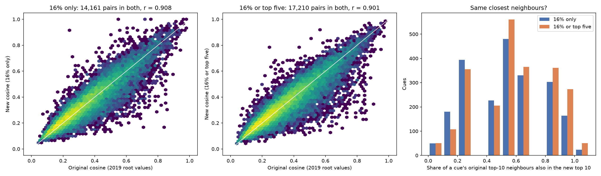

# Cosines: new processing vs the original (2019) processing

Do the new processing steps (`00`–`09`) give cue-cue cosines that are close to the original ones from the Word-Norms-2 project?

Code and outputs: [10_compare_cosines.ipynb](10_compare_cosines.ipynb), [processed/10_cosine_summary.csv](processed/10_cosine_summary.csv), [processed/10_cosine_comparison.csv](processed/10_cosine_comparison.csv) (every cue pair, 16% only).

## How it was done

- **New cosines:** the cosine between two cues' feature vectors, using each word's `prop_final` (the share of that cue's people who listed it) from [processed/09_cue_feature_counts.csv](processed/09_cue_feature_counts.csv).
  - **16% only:** a cue keeps only the features listed by 16% or more of its people. This was the requested comparison.
  - **16% or top five:** the rule the 2019 paper used, shown beside it so the effect of the top-five rule is visible.
- **Original cosines:** the root-word cosines in `all root values.txt` (Word-Norms-2, `4 analysis/datasets`), Buchanan cue pairs only (3,722 cues).
- **Matching the 2019 rules:**
  - The 2019 script (`dotcosine.pl`) only wrote a cosine when two cues shared more than one feature, so the same rule is applied to the new cosines.
  - Only non-zero pairs are in the original file, so a pair that is missing from one side counts as a cosine of 0.

## Results

| | 16% only | 16% or top five (2019 rule) |
|---|---|---|
| Cue pairs with a cosine, original | 40,107 | 40,107 |
| Cue pairs with a cosine, new | 17,326 | 22,411 |
| In both | 14,161 | 17,210 |
| Only in the original | 25,946 | 22,897 |
| Only in the new | 3,165 | 5,201 |
| Mean cosine in both, original / new | 0.362 / 0.361 | 0.360 / 0.353 |
| Pearson r, pairs in both | 0.908 | 0.901 |
| Spearman rho, pairs in both | 0.910 | 0.901 |
| Mean absolute difference, pairs in both | 0.052 | 0.052 |
| Pearson r, all pairs (missing = 0) | 0.436 | 0.452 |
| Share of a cue's original top-10 neighbours also in the new top 10 | 52% | 57% |

## What it shows

- **Where both have a cosine, they agree closely.** The correlation is about 0.9, the average cosine is almost identical, and a pair differs by about 0.05 on average.
- **The new data gives a cosine to fewer pairs.** With 16% only, 35% of the original pairs (14,161 of 40,107) have a cosine in the new data. With the 2019 rule it is 43%. So a cue's closest neighbours match only partly (52–57% of the top 10).

## Why the pair counts differ

This was not tested pair by pair, so treat it as the likely explanation:

- The 2019 processing translated word forms to a shared root, and merged more of them. For example `person` is a feature of 585 cues in the 2019 data but 183 in the new data. Cues that share a merged root get a cosine in the original but not in the new data.
- The 2019 data have about 6.6 features per cue. The new data have 5.0 at 16% only, and 5.9 with the top-five rule.
- The new data exclude whole answers (flagged wiki or dictionary text, rejected MTurk assignments, and so on) and some cues have fewer people left (`n_final`), which changes which features reach 16%.

## Caveats

- The two sets are not independent checks. They come from the same participants, so high agreement is expected.
- Only the root cosines are compared here, not the raw or affix cosines.
- The comparison covers the 3,722 Buchanan cues, not the McRae or Vinson cues in the same file.
